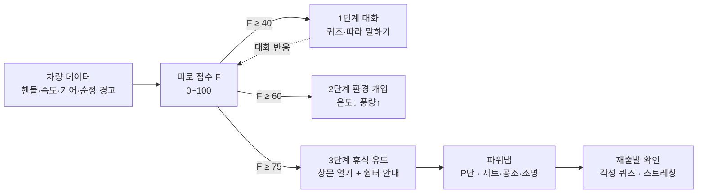

# 곁 — 혼자 운전하는 사람의 옆자리 졸음 메이트

> 카메라 없이 **차량 데이터만으로** 졸음을 알아채고, **말을 걸어** 깨우고, **쉼터로 안내**해 **파워냅**과 **재출발 확인**까지 챙기는 Pleos Connect 앱

2026 현대자동차그룹 차량용 앱 개발 공모전 (Pleos Connect) 출품작 · 팀 **motor_rookie**

| 시연 영상 | APK | 기획서 |
|---|---|---|
| [링크 추가 예정]() | [Releases v1.0](https://github.com/ddo0S2/motor_rookie/releases) | [docs/](docs/) |

---

## 무엇을 하나요

순정 운전자 주의 경고는 "휴식하세요"라는 경고로 끝납니다. **곁**은 그다음까지 이어집니다.



| 단계 | 조건 | 하는 일 | 사용 SDK |
|---|---|---|---|
| 감지 | 항상 | 연속 주행 시간, 핸들 미세 보정, 속도 변동, 대화 반응, 순정 경고로 피로 점수 계산 | Vehicle |
| 1단계 대화 | F ≥ 40 | 상식 퀴즈·따라 말하기를 음성으로 묻고 답을 음성으로 받음 | TextToSpeech, SpeechToText |
| 2단계 환경 | F ≥ 60 | 실내 온도 2℃ 낮추고 풍량 1단계 올림, [되돌리기] 제공 | Vehicle (HVAC) |
| 3단계 휴식 | F ≥ 75 | 창문 2개 30% 열기, 가까운 휴게소·졸음쉼터를 경유지(안내 중) 또는 목적지로 설정 | Vehicle (Window), NaviHelper |
| 파워냅 | 3단계 이후 P단 | 저장해 둔 시트 각도·온도·조명 적용 → 알람(점점 커짐)으로 기상 → 원래 설정 복원 | Vehicle (Seat·HVAC·Light·Gear) |
| 재출발 확인 | 기상 후 | 각성 퀴즈 3문제, 통과하면 출발 안내 / 필요하면 스트레칭 안내 | TextToSpeech, SpeechToText |
| 비상 모드 | 무응답 3회 · 급정거 | 비상등 → 2차 사고 예방 행동요령 음성 안내 → 112·119·긴급견인·비상연락처 연결 | TextToSpeech, SpeechToText |

- 단계 기준(40/60/75)은 설정의 민감도에 따라 조정됩니다.
- 내비 길안내가 끝나면 곁 화면으로 자동 복귀합니다.
- 주행 가능 거리가 부족하면 다음 휴게소 또는 가까운 주유소를 안내하고, 타이어 펑크·경고등·고장·화재 행동요령을 단계별로 안내합니다.

## 피로 점수

```
F = 100 × min(1, m × (0.25·s_time + 0.30·s_steer + 0.15·s_speed + 0.30·s_talk + 0.15·s_signal))
m = 야간 ×1.2 · 와이퍼 작동 ×1.1 · 정체 ×1.1 · 고속 직진 ×1.1
```

- 카메라를 쓰지 않아 영상 개인정보 부담이 없습니다.
- 처음 15분 주행으로 **운전자별 기준선**을 학습하고, 핸들·속도는 60km/h 이상 일정 주행일 때만 분석합니다.
- 의학적 진단이 아니라 **"언제 말을 걸지" 정하는 지표**입니다.
- 자세한 설명: [docs/detection.md](docs/detection.md)

## 구조

```
app/src/main/java/com/hyundai/motor_rookie/
├── MainActivity.kt   모듈 연결, 데이터 모드 스위치
├── vehicle/          차량 데이터 (실제 SDK / 테스트 시나리오 / CSV 재생을 같은 인터페이스로)
├── fatigue/          피로 점수 계산
├── intervention/     1~3단계 개입, 쉼터·내비, 비상 모드, 처음 설정 화면, 시뮬레이션 패널
├── ui/               파워냅 화면·흐름, 주행 메인 화면
├── speech/           파워냅 음성 (TTS·STT·알람)
├── alert/            단계 알림 음성
└── data/             파워냅 설정, 퀴즈, 알람음
app/src/main/assets/sim/   시연용 주행 데이터 (CSV)
docs/                      설계 문서, SDK 확인 결과
```

모듈 사이 약속: [docs/architecture.md](docs/architecture.md)

## 테스트 환경

| 항목 | 값 |
|---|---|
| 에뮬레이터 | Pleos Connect v2.1.0 (Android API 34) |
| 화면 규격 | 2560 × 1440 px, 160 dpi |
| 빌드 | Android Studio · AGP 8.5.0 · Gradle 8.7 · Kotlin 1.9.0 |
| SDK | compileSdk 34 · minSdk 28 · targetSdk 34 |
| Pleos SDK | Vehicle 2.3.2 · TextToSpeech 3.3.1 · SpeechToText 3.3.1 · NaviHelper 3.0.5 |

## 실행 방법

### APK로 바로 설치
1. [Releases](https://github.com/ddo0S2/motor_rookie/releases)에서 `gyeot-v1.0.apk`를 내려받습니다.
2. Pleos Connect 에뮬레이터를 켠 뒤 APK 파일을 에뮬레이터 화면에 끌어다 놓거나, `adb install gyeot-v1.0.apk`로 설치합니다.

### 소스로 빌드
1. 이 저장소를 Android Studio에서 엽니다.
2. `settings.gradle.kts`에 Pleos Maven 저장소(`nexus-playground.pleos.ai`)가 있는지 확인합니다.
3. Pleos Connect 에뮬레이터를 실행하고 ▶ Run 'app'.

### 필요한 설정
- **권한:** 처음 설정 화면에서 마이크·위치·차량(속도, 조향·기어) 권한을 허용합니다. 비상연락처는 정차 중에 등록할 수 있습니다.
- **Virtual Console (기어·속도 입력):** PC 터미널에서 `adb forward tcp:8088 tcp:8088` 실행 후 브라우저로 `http://127.0.0.1:8088/`에 접속합니다. 3단계(휴식 권장)가 된 뒤 여기서 기어를 P로 바꾸면 파워냅이 시작됩니다.
- **내비 연동:** 시뮬레이션 패널 설정 탭에서 "실제 내비"를 켜면 쉼터가 Pleos 내비에 경유지·목적지로 들어갑니다.

### 데이터 모드 (`MainActivity.kt`의 `dataMode`)
에뮬레이터는 실제로 주행하지 않아 핸들·속도 값이 변하지 않으므로, 세 가지 모드를 둡니다.

| 모드 | 내용 |
|---|---|
| `SCENARIO` (기본) | 시뮬레이션 패널에서 고른 운전 상태(정상~아주 졸림)로 핸들·속도를 만들어 냄. 기어는 Virtual Console 값 사용. 5배속, 기준선 학습 3분 |
| `CSV` | `assets/sim/drowsy_drive.csv`(약 2시간 34분 주행)를 재생해 단계가 차례로 진행됨 |
| `LIVE` | 에뮬레이터/실제 차 값 그대로 (Virtual Console 속도·핸들·기어) |

- 시뮬레이션 패널(감지 / 점수 / 설정 / 비상 탭)에서 점수 조정, 비상 상황 재현, 처음 상태로 초기화를 할 수 있습니다.
- 공조·창문·시트 같은 차량 제어는 에뮬레이터 차량에 실제로 적용됩니다.
- Logcat에서 `tag:FATIGUE`로 필터하면 피로 점수 계산식이 2초마다 출력됩니다.

| 파일 | 내용 |
|---|---|
| `drowsy_drive.csv` | 야간 고속도로 주행 중 점점 졸려지는 패턴 |
| `normal_drive.csv` | 졸음 없는 주행 (오탐 확인용) |

### 테스트
`app/src/test/.../fatigue/FatigueEngineTest.kt`의 ▶ 버튼 (에뮬레이터 없이 PC에서 실행)

## 팀

| 역할 | 맡은 부분 |
|---|---|
| 감지 (팀장) | 피로 점수 계산, 차량 데이터, 데이터 모드 |
| 단계별 개입·비상 모드 | 1~3단계 개입, 쉼터·내비 연동, 비상 모드, UI 디자인, 통합 |
| 파워냅 | 파워냅 환경 저장·적용·복원, 기상 알람, 재출발 확인 |

협업 규칙: [CONTRIBUTING.md](CONTRIBUTING.md)

## 안전·개인정보
- 주행 화면 버튼은 3개(말 걸어줘·쉼터 찾기·설정)이고, 대답은 음성으로 합니다.
- `distractionOptimized`를 선언하고, 주행 중에는 키보드 입력이 필요한 비상연락처 등록을 막습니다.
- 조향·제동은 건드리지 않습니다. 차량 제어는 공조·창문·시트·조명에 한정하고 원래 상태로 되돌릴 수 있습니다.
- 카메라를 쓰지 않으며, 앱 코드에 주행 데이터를 외부로 보내는 기능이 없습니다. 음성 인식은 온디바이스 모드를 씁니다.
