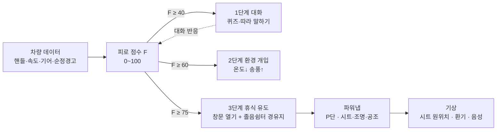

# 곁 (가칭) — 혼자 운전하는 사람의 옆자리 졸음 메이트

> 카메라 없이 **차량 데이터만으로** 졸음을 알아채고, **말을 걸어** 깨우고, **쉼터로 안내**해 **파워냅**까지 챙기는 Pleos Connect 앱

2026 현대자동차그룹 차량용 앱 개발 공모전 (Pleos Connect) 출품작 · 팀 **motor_rookie**

| 시연 영상 | APK | 기획서 |
|---|---|---|
| [YouTube 링크 넣기]() | [Releases](../../releases) | [docs/기획서.pdf](docs/) |

---

## 무엇을 하나요

순정 운전자 주의 경고(DAW)는 "휴식하세요"라는 경고로 끝납니다. **곁**은 그다음까지 이어집니다.



| 단계 | 조건 | 하는 일 | 사용 SDK |
|---|---|---|---|
| 감지 | 항상 | 연속 주행 시간 + 핸들 미세 보정 + 속도 변동 + 순정 경고로 피로 점수 계산 | Vehicle (Callback) |
| 1단계 대화 | F ≥ 40 | 짧은 퀴즈·따라 말하기로 각성 유도 | SpeechToText, TextToSpeech |
| 2단계 환경 | F ≥ 60 | 실내 온도 낮추기, 송풍 올리기 | Vehicle HVAC (Set) |
| 3단계 휴식 | F ≥ 75 | 창문 살짝 열기 + 가까운 졸음쉼터를 경유지로 추가 | Vehicle Window, NaviHelper |
| 파워냅 | 쉼터 도착 + P단 | 시트 눕히기, 온도·조명 조절 → 15분 뒤 원위치·환기·음성 기상 | Vehicle Seat·Light·HVAC·Gear |

## 피로 점수

```
F = 100 × min(1, m × (0.25·s_time + 0.30·s_steer + 0.15·s_speed + 0.30·s_talk + 0.15·s_signal))
m = 야간 ×1.2 · 비/눈 ×1.1 · 정체 ×1.1 · 고속 직진 ×1.1
```

- 카메라를 쓰지 않아 개인정보 부담이 없고, 처음 15분 주행으로 **운전자별 기준선**을 학습해 개인차를 줄입니다.
- 의학적 진단이 아니라 **"언제 말을 걸지" 정하는 지표**로 정의합니다.
- 자세한 설명: [docs/detection.md](docs/detection.md)

## 구조

```
app/src/main/java/com/hyundai/motor_rookie/
├── MainActivity.kt
├── vehicle/      차량 데이터 (실제 SDK / 시뮬레이션 CSV 를 같은 인터페이스로)
├── fatigue/      피로 점수 계산, 단계 결정, 디버그 패널
├── talk/         1단계 대화: 퀴즈 엔진, STT/TTS
├── climate/      2단계 환경 개입: 공조
├── rest/         3단계 휴식 유도: 창문, 쉼터 경유지
├── powernap/     파워냅: 시트·조명·공조 저장/적용/복원
└── ui/           화면 (Jetpack Compose)
app/src/main/assets/sim/   시연용 주행 데이터 (CSV)
tools/                     시뮬레이션 데이터 생성 스크립트
docs/                      기획서, 설계 문서, SDK 확인 결과
```

모듈 사이 약속(누가 무엇을 제공하고 호출하는지): [docs/architecture.md](docs/architecture.md)

## 실행 방법

### 준비물
- Android Studio (Ladybug 이상)
- Pleos Connect 에뮬레이터 v2.1.0 (API 34)
- Pleos Playground SDK 사용 신청 완료 계정

### 빌드
1. 이 저장소를 Android Studio 에서 엽니다.
2. `settings.gradle.kts` 에 Pleos Maven 저장소가 있는지 확인합니다.
3. 에뮬레이터를 실행하고 ▶ Run 'app'.

### 시뮬레이션 모드 (시연용)
에뮬레이터는 실제로 주행하지 않아 핸들·속도 값이 변하지 않습니다.
**설정 > 시뮬레이션 모드**를 켜면 `assets/sim/drowsy_drive.csv`(약 2시간 30분 주행)를 60배속으로 재생해,
약 2분 30초 안에 `관찰 → 대화 → 공조 → 쉼터 안내 → 휴식` 전 과정을 볼 수 있습니다.
공조·창문·시트 같은 **차량 제어(Set)는 실제 에뮬레이터 차량에 그대로 적용**됩니다.

| 파일 | 내용 |
|---|---|
| `drowsy_drive.csv` | 야간 고속도로 → 95분부터 서서히 졸림 → 115분부터 심하게 졸림 → 쉼터 진입 후 P단 |
| `normal_drive.csv` | 같은 길이, 졸음 없음 (오탐 확인용) |

### 테스트
`app/src/test/.../FatigueEngineTest.kt` 의 ▶ 버튼 (에뮬레이터 없이 PC에서 실행)

## 팀

| 역할 | 담당 | 맡은 부분 |
|---|---|---|
| 감지 | 박소영 | `vehicle/`, `fatigue/`, 주행 메인 화면, 시뮬레이션 모드 |
| 대화·환경 개입 | [이름] | `talk/`, `climate/`, 대화 화면 |
| 휴식 유도·파워냅 | [이름] | `rest/`, `powernap/`, 쉼터·파워냅 화면 |

협업 규칙: [CONTRIBUTING.md](CONTRIBUTING.md)

## 안전·개인정보
- 주행 중 조작은 음성 위주, 화면 버튼은 최대 3개. 시트·차량 설정은 정차 중에만.
- 조향·제동은 건드리지 않습니다. 차량 제어는 공조·창문·시트·조명에 한정하고 항상 [되돌리기]를 제공합니다.
- 주행 데이터는 차량 안에만 저장합니다.
